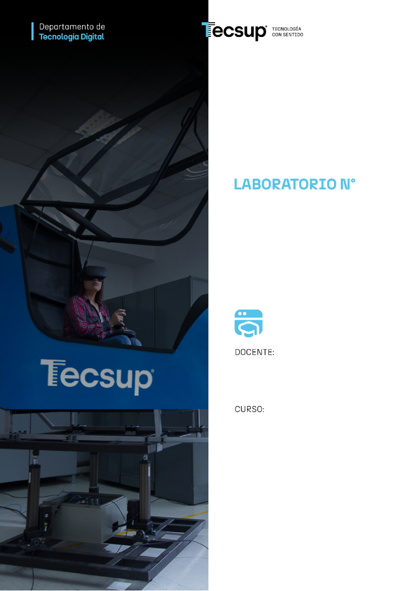
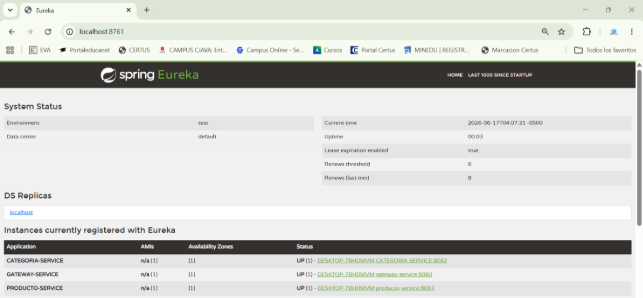

Desarrollo de Aplicaciones Web: 4 C24 Sección A B

Clases, atributos y métodos

`                                `**13**

**Desarrollo de aplicaciones Web:** Service Discovery y Gateway.

Coello Palomino, Ricardo

Desarrollo de aplicaciones Web

4 - C24 - Sección A B 

**DESARROLLO DE APLICACIONES WEB AVANZADO: Service Discovery y Gateway.**

1. **Capacidades**

   Implementar service discovery y API Gateway.

1. **Seguridad**
- En este laboratorio está prohibida la manipulación del hardware, conexiones eléctricas o de red. Así como la ingesta de alimentos y bebidas. 
- Ubicar maletines y/o mochilas en lugar destinado para tal fin.
- Dejar la mesa de trabajo y la silla utilizada limpias y ordenadas.

1. **Fundamento teórico**
- Revise el material de la semana correspondiente antes del desarrollo del laboratorio.

1. **Normas empleadas**
- *No aplica*

1. **Recursos**
- En este laboratorio, cada estudiante trabajará con una computadora con Windows 10.
- La instalación del software requerido se realizará en el equipo virtual.

1. **Metodología para el desarrollo de la tarea**
- El desarrollo del laboratorio es individual

1. **Procedimiento**

**IMPLEMENTACIÓN DE API GATEWAY**

1\. Crear el siguiente proyecto Maven(https://start.spring.io/):

Project: Maven

Languaje: Java

Spring Boot: 3.5.15

Project Metadata:

`	`Group: com.tecsup

`	`Artifact: gateway-service

`	`Package name: com.tecsup

Packaging: jar

Configuration: YAML

Java: 17

Dependencias:

- Spring Cloud Gateway
- Eureka Discovery Client

2\. Agregar el proyecto a la carpeta microservicios.

3\. File / New / Module from Existing Sources

- Seleccionar la carpeta gateway-server
- Import from external model
- Maven
- Finalizar

Nota: Click derecho al archivo pom.xml / Maven ….

4\. Revisar el archivo pom.xml

*<?*xml version="1.0" encoding="UTF-8"*?>*\
\
<project xmlns="http://maven.apache.org/POM/4.0.0"\
`         `xmlns:xsi="http://www.w3.org/2001/XMLSchema-instance"\
`         `xsi:schemaLocation="\
`         `http://maven.apache.org/POM/4.0.0\
`         `https://maven.apache.org/xsd/maven-4.0.0.xsd">\
`    `<modelVersion>4.0.0</modelVersion>\
`    `<parent>\
`        `<groupId>org.springframework.boot</groupId>\
`        `<artifactId>spring-boot-starter-parent</artifactId>\
`        `<version>3.5.3</version>\
`    `</parent>\
\
`    `<groupId>com.tecsup</groupId>\
`    `<artifactId>gateway-service</artifactId>\
`    `<version>0.0.1-SNAPSHOT</version>\
`    `<name>gateway-service</name>\
\
`    `<properties>\
`        `<java.version>17</java.version>\
`    `</properties>\
\
`    `<dependencyManagement>\
`        `<dependencies>\
`            `<dependency>\
`                `<groupId>org.springframework.cloud</groupId>\
`                `<artifactId>spring-cloud-dependencies</artifactId>\
`                `<version>2025.0.0</version>\
`                `<type>pom</type>\
`                `<scope>import</scope>\
`            `</dependency>\
`        `</dependencies>\
`    `</dependencyManagement>\
\
`    `<dependencies>\
`        `<dependency>\
`            `<groupId>org.springframework.cloud</groupId>\
`            `<artifactId>spring-cloud-starter-gateway</artifactId>\
`        `</dependency>\
\
`        `<dependency>\
`            `<groupId>org.springframework.cloud</groupId>\
`            `<artifactId>spring-cloud-starter-netflix-eureka-client</artifactId>\
`        `</dependency>\
\
`        `<dependency>\
`            `<groupId>org.springframework.cloud</groupId>\
`            `<artifactId>spring-cloud-starter-loadbalancer</artifactId>\
`        `</dependency>\
\
`        `<dependency>\
`            `<groupId>org.springframework.boot</groupId>\
`            `<artifactId>spring-boot-starter-actuator</artifactId>\
`        `</dependency>\
\
`        `<dependency>\
`            `<groupId>org.springframework.boot</groupId>\
`            `<artifactId>spring-boot-starter-test</artifactId>\
`            `<scope>test</scope>\
`        `</dependency>\
\
`    `</dependencies>\
</project>

5\. Modificar el archivo principal

package com.tecsup;\
\
import org.springframework.boot.SpringApplication;\
import org.springframework.boot.autoconfigure.SpringBootApplication;\
import org.springframework.cloud.client.discovery.EnableDiscoveryClient;\
\
@SpringBootApplication\
@EnableDiscoveryClient\
public class GatewayServiceApplication {\
\
`    `public static void main(String[] args) {\
`       `SpringApplication.*run*(GatewayServiceApplication.class, args);\
`    `}\
\
}

6\. Escribir el siguiente código en el archivo  “application.yaml”

server:\
`  `port: 8080\
\
spring:\
`  `application:\
`    `name: gateway-service\
\
`  `cloud:\
`    `gateway:\
`      `discovery:\
`        `locator:\
`          `enabled: true\
`          `lower-case-service-id: true\
\
`      `routes:\
\
`        `- id: categoria-service\
`          `uri: lb://categoria-service\
`          `predicates:\
`            `- Path=/api/categorias/\*\*\
\
`        `- id: producto-service\
`          `uri: lb://producto-service\
`          `predicates:\
`            `- Path=/api/productos/\*\*\
\
logging:\
`  `level:\
`    `org.springframework.cloud.gateway: DEBUG\
`    `org.springframework.cloud.loadbalancer: DEBUG\
\
eureka:\
`  `client:\
`    `register-with-eureka: true\
`    `fetch-registry: true\
`    `service-url:\
`      `defaultZone: http://localhost:8761/eureka\

6\. Ejecuta los siguientes servicios.

- Eureka-server
- Categoría-service
- Producto-service
- Gateway-service

7\. Revisar Eureka-Server

<http://localhost:8080/api/categorias>

<http://localhost:8080/api/productos>

**Actividad**

Publicar los servicios “cliente-service” y “pedido-service” mediante el Gateway.

**Conclusiones:**

Indicar 5 conclusiones que llegó después de los temas tratados de manera práctica en este laboratorio.

|||
| :- | :- |
|||
|||
|||
|||
|||

